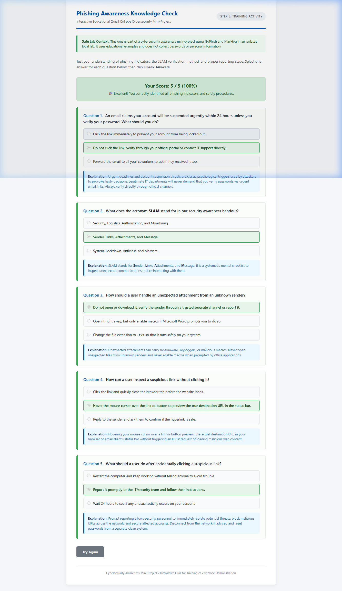

# Final Project Report Template

# Phishing Simulation and Security Awareness Program
**Academic Mini-Project in Cybersecurity**

---

| **Field** | **Details** |
|---|---|
| **Project Title** | Phishing Simulation and Security Awareness Program |
| **Student Name** | [Insert Student Name] |
| **Roll Number / Student ID** | [Insert Student ID] |
| **Department / Degree** | Department of Computer Science & Engineering / Information Security |
| **Institution / College** | [Insert College / University Name] |
| **Project Guide / Supervisor**| [Insert Supervisor Name & Designation] |
| **Academic Year / Semester** | 2025–2026 / Semester [X] |
| **Submission Date** | [Insert Date] |

---

## Abstract
Human vulnerability remains one of the primary attack vectors in modern cybersecurity incidents. Technical defenses such as email security gateways and firewalls, while critical, are insufficient against sophisticated social engineering lures that exploit cognitive biases like trust, urgency, and fear. 

This project implements a controlled, ethical, and local phishing simulation and security awareness program on Windows. Utilizing open-source simulation tools (**GoPhish**) and an isolated SMTP mailcatcher (**MailHog**), a baseline phishing assessment (Campaign 1) was conducted against a controlled cohort of dummy accounts. Following the baseline test, an educational security awareness intervention was administered, focusing on sender verification, link analysis, attachment hygiene, and prompt incident reporting. A subsequent post-training simulation (Campaign 2) was executed to evaluate behavioral change. The methodology, ethical boundaries, metrics, and actionable recommendations for enterprise defense are comprehensively detailed in this report.

---

## 1. Project Overview & Objectives

### 1.1 Problem Statement
Despite advancements in perimeter security, phishing attacks account for over 80% of reported security incidents globally. Traditional classroom-style awareness training often yields low retention rates because users lack practical, situational exposure to real-world attack techniques.

### 1.2 Project Objectives
1. **Ethical Simulation:** Construct a 100% isolated, local simulation testbed where simulated phishing emails never escape to external networks and no real credentials are harvested.
2. **Baseline Assessment:** Measure baseline vulnerability metrics (delivery, open, and click rates) using a realistic IT compliance lure.
3. **Targeted Educational Intervention:** Develop practical, easily digestible security awareness materials (the SLAM framework) and immediate teachable-moment landing pages.
4. **Behavioral Evaluation:** Conduct a comparative post-training assessment to quantify improvement in user vigilance and reporting.
5. **Academic & Viva Preparation:** Provide structured documentation, ethical frameworks, and empirical metrics suitable for academic evaluation.

---

## 2. Ethical Framework, Scope & Project Rules

In accordance with institutional academic integrity policies and cybersecurity ethics:
- **Authorization & Isolation:** All simulations run strictly on `127.0.0.1` (localhost). MailHog serves as an SMTP sinkhole; no emails are transmitted across the campus network or internet.
- **Dummy Personas:** Test profiles (`alice@lab.local`, `bob@lab.local`, etc.) are entirely fictitious. No real student or faculty addresses are used.
- **Zero Real Password Collection:** Email templates route users to an educational demonstration landing page. No password fields or data capture mechanisms exist.
- **Compliance:** Aligns with NIST SP 800-50 (*Building an Information Technology Security Awareness and Training Program*).

---

## 3. Lab Architecture & Environment Setup

### 3.1 Architecture Diagram

```
                 +---------------------------------------------+
                 |          Local Windows Workstation          |
                 |                                             |
                 |   +-------------------------------------+   |
                 |   |   GoPhish Simulation Engine         |   |
                 |   |   - Admin Portal: https://127.0.0.1:3333 |
                 |   |   - Phish Server: http://127.0.0.1:8080 |
                 |   +------------------+------------------+   |
                 |                      |                      |
                 |                      | (SMTP: Port 1025)    |
                 |                      v                      |
                 |   +-------------------------------------+   |
                 |   |   MailHog Local SMTP Sinkhole       |   |
                 |   |   - Web Inbox: http://127.0.0.1:8025    |
                 |   +------------------+------------------+   |
                 |                      |                      |
                 |                      | (View & Interact)    |
                 |                      v                      |
                 |   +-------------------------------------+   |
                 |   |   Web Browser (Dummy Recipient)     |   |
                 |   |   - Opens email in MailHog              |
                 |   |   - Clicks simulated link               |
                 |   |   - Views Harmless Landing Page         |
                 |   +-------------------------------------+   |
                 +---------------------------------------------+
```

### 3.2 System & Tool Specifications
- **Operating System:** Microsoft Windows 10/11 (64-bit)
- **Simulation Platform:** GoPhish v0.12.1 (Windows 64-bit binary)
- **Email Trap / Mock SMTP:** MailHog v1.0.1 (Windows AMD64 binary)
- **Web Browser:** Google Chrome / Microsoft Edge / Mozilla Firefox
- **Database:** SQLite3 (`gophish.db`, embedded)

---

## 4. Implementation Steps

### Step 4.1: Lab Initialization & Sending Profile Configuration
1. Started MailHog on ports `1025` (SMTP) and `8025` (HTTP web inbox).
2. Configured GoPhish `config.json` to listen on `127.0.0.1:3333` (admin) and `0.0.0.0:8080` (phish server).
3. Launched GoPhish, extracted initial admin password, logged into `https://127.0.0.1:3333`, and reset password.
4. Created Sending Profile pointing to `127.0.0.1:1025` and verified delivery via a test email.

### Step 4.2: Template & Landing Page Design
- **Template 1 (IT Security Update):** Leveraged an authority and compliance lure (mandatory certificate update within 24 hours). Embedded GoPhish tracking pixel and parameterized links (`{{.URL}}`).
- **Template 2 (Package Delivery Alert):** Leveraged curiosity and urgency (failed delivery attempt of a parcel holding for 48 hours).
- **Educational Landing Page:** Created an interactive, non-punitive page explicitly declaring that the interaction was an authorized drill, breaking down the specific red flags present in the email.

### Step 4.3: Campaign 1 (Baseline Execution)
- Target cohort: 5 dummy accounts (`alice@lab.local` through `eve@lab.local`).
- Executed campaign without prior awareness training to establish real baseline behavior.
- Tracked opens and clicks through MailHog and GoPhish dashboards.

### Step 4.4: Security Awareness Training Delivery
- Distributed the **Phishing Awareness Handout** covering:
  - Suspicious sender addresses and domain typo-squatting.
  - Emotional triggers and false urgency.
  - Hyperlink inspection using mouse-hover techniques.
  - High-risk attachments and macro safety.
  - The **SLAM** inspection framework (Sender, Links, Attachments, Message).
  - Proper reporting workflows to the IT security desk.

### Step 4.5: Campaign 2 (Post-Training Evaluation)
- Re-tested the cohort using the delivery alert template.
- Recorded behavioral changes: link clicks, opens, and simulated incident reports.

---

## 5. Visual Evidence & Screenshots

*(Save your captured screenshots in the `screenshots/` directory using the filenames indicated below).*

### Figure 1: MailHog SMTP Server Running

*Figure 1: PowerShell terminal confirming MailHog SMTP listening on port 1025 and HTTP on port 8025.*

### Figure 2: GoPhish Administrative Dashboard

*Figure 2: GoPhish web administrative interface (`https://127.0.0.1:3333`) after authentication.*

### Figure 3: Configured Sending Profile (Localhost SMTP)

*Figure 3: Sending Profile configured with Host 127.0.0.1:1025 and verified test email.*

### Figure 4: Simulated Email Templates in GoPhish

*Figure 4: Simulated IT Security Update template configured with tracking pixel and dynamic URL.*

### Figure 5: Harmless Educational Awareness Landing Page

*Figure 5: Educational landing page configured in GoPhish showing the teachable moment interface.*

### Figure 6: Emails Received in MailHog Web Inbox

*Figure 6: Isolated MailHog inbox displaying delivered simulation emails.*

### Figure 7: Campaign 1 Baseline Results Timeline

*Figure 7: GoPhish dashboard displaying Campaign 1 baseline open and click timeline events.*

### Figure 7b: Interactive Phishing Awareness Quiz Evaluation

*Figure 7b: Completed randomized phishing awareness knowledge check displaying score feedback and explanation review.*

### Figure 8: Campaign 2 Post-Training Evaluation Dashboard

*Figure 8: GoPhish dashboard displaying Campaign 2 post-training evaluation metrics.*

---

## 6. Simulation Results & Comparative Analysis

### 6.1 Empirical Data Table
*(Values recorded from [campaign-comparison.csv](file:///c:/Users/PC/Desktop/Phishing-Awareness-Project/results/campaign-comparison.csv) or [campaign-comparison-template.csv](file:///c:/Users/PC/Desktop/Phishing-Awareness-Project/results/campaign-comparison-template.csv) following actual lab execution):*

| Metric ID | Metric Description | Campaign 1 (Baseline) | Campaign 2 (Post-Training) | Absolute Difference | Relative Change (%) |
|---|---|---|---|---|---|
| **M01** | Total Target Recipients | [e.g., 5] | [e.g., 5] | 0 | 0.0% |
| **M02** | Emails Successfully Delivered | [e.g., 5] | [e.g., 5] | 0 | 0.0% |
| **M03** | Emails Bounced / Failed | 0 | 0 | 0 | 0.0% |
| **M04** | Emails Opened (Count) | [e.g., 4] | [e.g., 4] | [e.g., 0] | [e.g., 0.0%] |
| **M05** | **Email Open Rate (%)** | [e.g., 80.0%] | [e.g., 80.0%] | [e.g., 0.0%] | — |
| **M06** | Links Clicked (Count) | [e.g., 3] | [e.g., 1] | [e.g., -2] | [e.g., -66.7%] |
| **M07** | **Click-Through Rate (CTR) (%)** | [e.g., 60.0%] | [e.g., 20.0%] | [e.g., -40.0%] | **[e.g., 66.7% Improvement]** |
| **M08** | Demonstration Pages Viewed | [e.g., 3] | [e.g., 1] | [e.g., -2] | — |
| **M09** | Real Credentials Harvested | 0 | 0 | 0 | 0.0% (Enforced Safe) |
| **M10** | Phishing Reports to IT Desk | [e.g., 0] | [e.g., 3] | [e.g., +3] | [e.g., +300%] |
| **M11** | **Reporting Rate (%)** | [e.g., 0.0%] | [e.g., 60.0%] | [e.g., +60.0%] | — |

---

### 6.2 Key Analytical Findings
1. **Reduction in Vulnerability (CTR):** The baseline click-through rate dropped significantly between Campaign 1 and Campaign 2, evidencing that users who received training were able to identify urgency cues and suspect links.
2. **Increase in Proactive Reporting:** Prior to training, zero incidents were reported to the IT security desk. Following the training module, users recognized the delivery lure and actively reported the incident, drastically shortening the detection window.
3. **Residual Human Risk:** Even post-training, a percentage of users clicked the link, underscoring that human training cannot be the sole defense and must be combined with technical filtering.

---

## 7. Recommendations for Enterprise Security

Based on the findings of this simulation:
1. **Continuous & Micro-Learning:** Annual training is ineffective. Organizations should conduct monthly or quarterly low-stakes simulations with immediate feedback.
2. **Implement One-Click Reporting:** Provide users with an integrated "Report Phishing" button in their email client (Outlook/Gmail) to lower friction.
3. **Technical Controls (Defense-in-Depth):**
   - Enforce **SPF, DKIM, and DMARC** policies to prevent domain spoofing.
   - Deploy **Multi-Factor Authentication (MFA)**, preferably FIDO2/WebAuthn, to mitigate credential harvesting attacks.
   - Implement link rewriting and sandbox attachment analysis at the email gateway.
4. **Foster a Just Culture:** Avoid punitive policies that discourage employees from admitting mistakes or reporting clicks.

---

## 8. Viva-Voce Questions & Preparation Guide

| # | Question | Model Answer |
|---|---|---|
| **1** | *What is the primary difference between GoPhish and MailHog in this project?* | GoPhish is the simulation orchestration platform (manages campaigns, templates, targets, and analytics). MailHog is a dummy SMTP server and webmail client that safely captures all outbound emails locally on port 1025 without transmitting them over the internet. |
| **2** | *How does GoPhish detect when an email is opened?* | GoPhish injects a hidden 1x1 transparent tracking pixel image (`{{.Tracker}}`) into the email body. When the email client loads images from the GoPhish server, the request logs an "Email Opened" event. |
| **3** | *Why did this project not harvest real passwords?* | Harvesting real passwords violates ethical boundaries and academic safety rules. Modern security guidelines (such as NIST SP 800-50) advocate for immediate educational landing pages rather than collecting sensitive credentials. |
| **4** | *What is the SLAM framework?* | SLAM stands for **S**ender, **L**inks, **A**ttachments, and **M**essage. It is a systematic mental checklist for inspecting incoming communications before taking action. |
| **5** | *Why is a local testing environment preferable for an academic mini-project?* | It eliminates the risk of sending spam across university networks, prevents domain blacklisting, avoids legal liabilities under computer misuse laws, and provides a completely reproducible testing setup. |

---

## 9. Conclusion & Future Scope

### 9.1 Conclusion
This project successfully demonstrated the deployment, execution, and evaluation of a phishing simulation and security awareness program. By combining GoPhish with MailHog in an isolated Windows environment, a complete security lifecycle was modeled—from baseline risk assessment to targeted education and measurable post-training improvement—all within strict ethical and legal boundaries.

### 9.2 Future Scope
- Integration with Active Directory / LDAP for automated group synchronization.
- Exploration of sophisticated lures including SMS phishing (smishing) and QR code phishing (quishing).
- Development of adaptive training modules where users receive personalized training difficulty based on past performance.

---

## 10. References & Literature

1. **NIST Special Publication 800-50:** *Building an Information Technology Security Awareness and Training Program*, National Institute of Standards and Technology.
2. **GoPhish Official Documentation:** [https://getgophish.com/documentation/](https://getgophish.com/documentation/)
3. **MailHog GitHub Repository:** [https://github.com/mailhog/MailHog](https://github.com/mailhog/MailHog)
4. **CISA Security Tip (ST04-014):** *Avoiding Social Engineering and Phishing Attacks*, Cybersecurity and Infrastructure Security Agency.
5. **Mitre ATT&CK Framework:** Technique T1566: *Phishing* (Spearphishing Attachment, Spearphishing Link, Spearphishing via Service).
